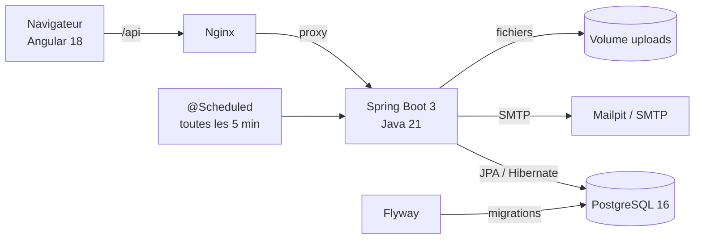
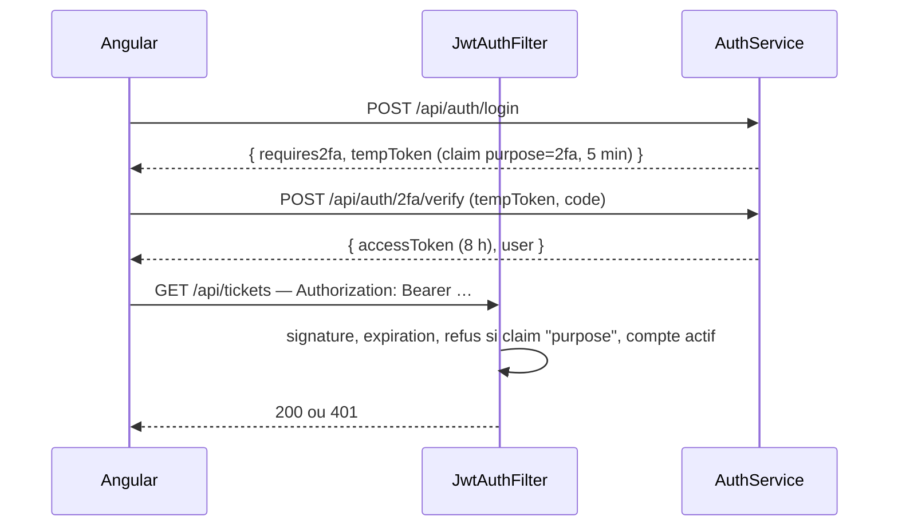
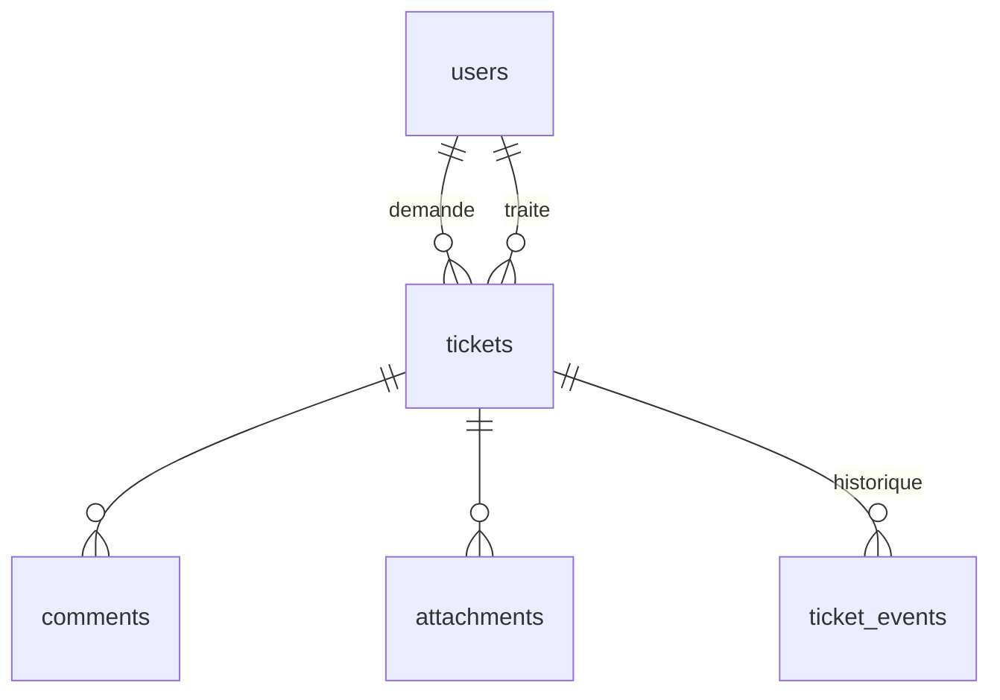

# Architecture

## Couches du backend

| Paquet | Rôle |
|---|---|
| `domain` | Entités JPA, énumérations, dépôts Spring Data |
| `sla` | **Règles métier pures** (délais, workflow) : aucune dépendance à Spring, testées en JUnit simple |
| `security` | Filtre JWT, configuration Spring Security (sans état), limitation des tentatives |
| `auth` | Connexion, double authentification TOTP |
| `ticket` | Service applicatif, contrôleur REST, filtres dynamiques (Specification), stockage des pièces jointes, tâche planifiée des délais |
| `notification` | E-mails (un échec d'envoi ne bloque jamais l'action) |
| `stats` | Indicateurs du tableau de bord |
| `common` | Erreurs au format RFC 7807 (`ProblemDetail`) |

## Sécurité

- Contrôle d'accès à deux niveaux : **URL** (`/api/stats/**` réservé au support) et **méthode** (`@PreAuthorize` sur la gestion des comptes).
- Cloisonnement des données dans le service : un utilisateur ne lit que ses tickets, ne voit jamais les notes internes, ne peut pas en écrire.
- Pièces jointes : liste blanche de types, 10 Mo, stockage sous un nom aléatoire, téléchargement soumis aux mêmes droits que le ticket.

## Modèle de données

Géré par **Flyway** (`backend/src/main/resources/db/migration`) ; Hibernate se contente de **valider** le schéma (`ddl-auto: validate`).

